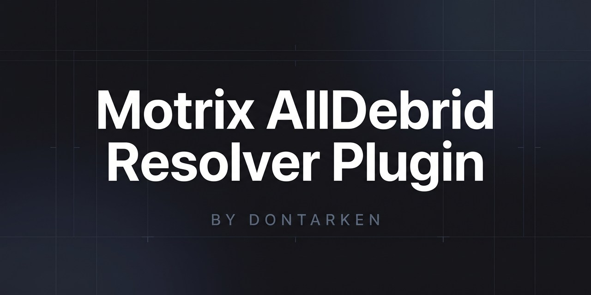

<p align="center">
  
</p>

# Plugin AllDebrid pour Motrix

<p align="center">
  
  &nbsp;&nbsp;&nbsp;&nbsp;&nbsp;&nbsp;&nbsp;&nbsp;
  
</p>

<p align="center">
  <b>Débridez et téléchargez vos fichiers à la vitesse maximale de votre fibre dans une interface moderne et épurée.</b>
</p>

<p align="center">
  <a href="https://github.com/DonTarken/motrix-plugin-alldebrid/releases/latest"></a>
  <a href="https://motrix.app"></a>
  <a href="LICENSE"></a>
  <a href="https://ko-fi.com/dontarken"></a>
</p>

<p align="center">
  🇫🇷 <b>Français</b> &nbsp;|&nbsp; <a href="README.md">🇬🇧 English</a>
</p>

---

## Pourquoi ce plugin ?

Vous utilisez **Motrix** comme gestionnaire de téléchargement et vous possédez un compte premium **AllDebrid** ?

Ce plugin officiel autonome (`.moext`) transforme Motrix en une alternative moderne, ultra-rapide et légère à **JDownloader** :
- **Débridage 100% automatique** : collez vos liens (1fichier, Rapidgator, Turbobit, Mega, Katfile, etc.), Motrix les débride et lance le téléchargement immédiatement.
- **Configuration simple par Clé API** : un simple copier-coller de votre clé API AllDebrid dans les paramètres de l'extension et le tour est joué.
- **Vitesse maximale** : sature votre connexion (jusqu'à 100+ Mo/s sur fibre) grâce au moteur multi-connexions Aria2.
- **100% Autonome** : s'installe directement dans le Motrix officiel de base sans aucune modification requise.

---

## 🚀 Tutoriel d'Installation Rapide

### Étape 1 : Installer l'extension dans Motrix (au choix)

#### Méthode A : Directement via GitHub (Recommandée — la plus simple)
1. Ouvrez **Motrix** et cliquez sur l'onglet **« Extensions »** dans la barre latérale gauche (icône 📦 sous *Trackers*).
2. Cliquez sur le bouton **`+`** tout en haut à droite pour ouvrir la fenêtre *« Ajouter une extension »*.
3. Dans le champ, saisissez simplement le nom du dépôt :
   ```text
   DonTarken/motrix-plugin-alldebrid
   ```
   *(Le badge en bas affichera **`Type détecté : GitHub`** — veillez à ne pas mettre `https://` devant pour que Motrix interroge directement les releases GitHub).*
4. Cliquez sur l'icône loupe 🔍 en bas à droite (ou appuyez sur Entrée). Motrix télécharge automatiquement la dernière version officielle et vous demande de confirmer l'installation !

---

#### 📁 Méthode B : Par fichier `.moext` local
1. 👉 **[Téléchargez `alldebrid-resolver.moext`](https://github.com/DonTarken/motrix-plugin-alldebrid/releases/latest/download/alldebrid-resolver.moext)** (dernière version).
2. Dans Motrix ➔ onglet **Extensions** ➔ cliquez sur le bouton **`+`** en haut à droite.
3. **Glissez-déposez** le fichier téléchargé directement dans le champ de la fenêtre, ou cliquez sur l'icône trombone 📎 pour le sélectionner sur votre disque.
4. Confirmez l'installation.

---

### Étape 2 : Renseigner votre Clé API AllDebrid
1. Sur la page **Extensions**, repérez la carte **AllDebrid Resolver** et cliquez sur le bouton **« Ouvrir »**.
2. Récupérez votre clé API sur votre compte AllDebrid : **[alldebrid.com/apikeys](https://alldebrid.com/apikeys)**.
3. Collez votre clé dans le champ **Clé API AllDebrid** et sauvegardez.
4. Une notification confirme immédiatement que votre compte **Premium est actif** avec vos jours d'abonnement restants. C'est prêt ! 🎉

---

## 💡 Utilisation au quotidien

* **Téléchargement individuel :** Copiez un lien d'hébergeur et collez-le dans Motrix (`Ctrl + N` ou bouton `+`).
* **Téléchargement par lot (Batch) :** Collez 10, 20 ou 50 liens d'archives découpées d'un coup (`.part01.rar`, `.part02.rar`...) : ils sont tous débridés et mis en file d'attente automatiquement.
* **Extension de navigateur :** Utilisez l'extension officielle Motrix pour Chrome ou Firefox : un simple clic droit **« Télécharger avec Motrix »** sur un lien d'hébergeur suffit !

---

## ❓ FAQ & Dépannage

<details>
<summary><b>Mon débit oscille ou la jauge reste bloquée à 0 o/s, que faire ?</b></summary>
<br>

Si vous téléchargez de très gros fichiers (fichiers vidéo de 20 à 60 Go), vérifiez où Motrix enregistre vos fichiers :
- **Préférez un disque SSD (SATA ou NVMe)** plutôt qu'un vieux disque dur mécanique (HDD à 5400 RPM).
- Sur un disque dur mécanique lent, l'allocation d'un fichier de 50 Go peut saturer l'écriture disque pendant plusieurs minutes, ce qui fige temporairement la jauge d'Aria2.
- Sur SSD, l'espace est alloué instantanément et le débit monte immédiatement à 90–115 Mo/s sur connexion fibre 1 Gbps.
</details>

<details>
<summary><b>Quels sont les hébergeurs pris en charge ?</b></summary>
<br>

Tous les hébergeurs supportés par votre compte AllDebrid : 1fichier, Rapidgator, Turbobit, Mega, Katfile, DDownload, Uptobox, Filefactory, Nitroflare, etc. Le plugin met à jour dynamiquement sa liste d'hébergeurs supportés chaque heure.
</details>

<details>
<summary><b>Mes identifiants sont-ils en sécurité ?</b></summary>
<br>

**Absolument.** Le plugin n'a jamais accès à votre mot de passe AllDebrid. Votre clé API personnelle est stockée localement sur votre ordinateur dans les données sécurisées de Motrix.
</details>

---

## 🐛 Un bug ? Une suggestion ?

Votre retour nous intéresse pour améliorer constamment le plugin !

* 👉 **[Signaler un bug (Bug Report)](https://github.com/DonTarken/motrix-plugin-alldebrid/issues/new?template=bug_report.yml)** : si un lien ne se débride pas ou si vous rencontrez une erreur.
* 👉 **[Proposer une amélioration](https://github.com/DonTarken/motrix-plugin-alldebrid/issues/new?template=feature_request.yml)** : si vous avez une idée de fonctionnalité.

---

## 🛠️ Compilation manuelle (Développeurs)

Si vous souhaitez modifier le code ou recompiler l'archive `.moext` :

```bash
# Cloner le dépôt
git clone https://github.com/DonTarken/motrix-plugin-alldebrid.git
cd motrix-plugin-alldebrid

# Compiler le paquet
npm run build
```

Le fichier compilé est automatiquement généré dans `dist/alldebrid-resolver.moext`.

---

## 💖 Soutenir le projet

Si ce plugin vous est utile et facilite vos téléchargements au quotidien, vous pouvez soutenir son développement et sa maintenance en m'offrant un café ! Chaque geste compte ☕

<p align="center">
  <a href="https://ko-fi.com/dontarken" target="_blank">
    
  </a>
</p>

---

## 📄 Licence

Ce projet est distribué sous licence open-source **[MIT](LICENSE)**.  
Développé avec passion par **[DonTarken](https://github.com/DonTarken)**.
