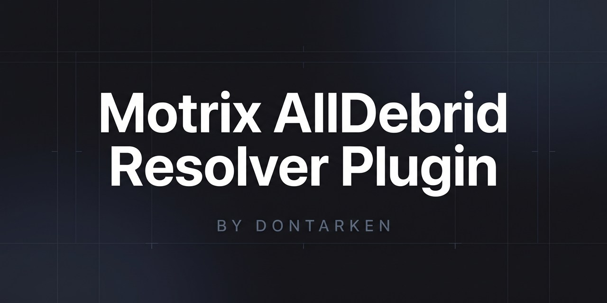

<p align="center">
  
</p>

# AllDebrid Resolver Plugin for Motrix

<p align="center">
  
  &nbsp;&nbsp;&nbsp;&nbsp;&nbsp;&nbsp;&nbsp;&nbsp;
  
</p>

<p align="center">
  <b>Unrestrict and download files at full gigabit fiber speed within a sleek, modern UI.</b>
</p>

<p align="center">
  <a href="https://github.com/DonTarken/motrix-plugin-alldebrid/releases/latest"></a>
  <a href="https://motrix.app"></a>
  <a href="LICENSE"></a>
  <a href="https://ko-fi.com/dontarken"></a>
</p>

<p align="center">
  <a href="README.fr.md">🇫🇷 Lire en Français</a> &nbsp;|&nbsp; 🇬🇧 <b>English</b>
</p>

---

## Why Use This Plugin?

Do you use **Motrix** as your daily download manager and hold an **AllDebrid** premium subscription?

This autonomous official plugin (`.moext`) transforms Motrix into a modern, lightning-fast, and lightweight alternative to **JDownloader**:
- **100% Automatic Unrestricting**: Paste any supported link (1fichier, Rapidgator, Turbobit, Mega, Katfile, etc.), and Motrix instantly unlocks the high-speed CDN stream.
- **Simple API Key Configuration**: Quickly paste your personal API key into the extension settings and you're good to go.
- **Max Throughput**: Saturates your gigabit fiber connection (up to 100+ MB/s) powered by Motrix's Aria2 multi-connection engine.
- **100% Autonomous**: Runs on vanilla, unpatched Motrix 2.0+ with zero core modifications required.

---

## 🚀 Quick Installation Guide

### Step 1: Install the Extension in Motrix (Choose One)

#### Method A: Directly via GitHub (Recommended — Fastest)
1. Open **Motrix** and click on the **"Extensions"** tab in the left navigation sidebar (package icon 📦 below *Trackers*).
2. Click the **`+`** button in the upper-right corner to open the *"Add an extension"* modal.
3. In the input field, simply enter the repository name:
   ```text
   DonTarken/motrix-plugin-alldebrid
   ```
   *(The badge below will switch to **`Detected type: GitHub`** — make sure not to prefix it with `https://` so Motrix queries GitHub releases directly).*
4. Click the search icon 🔍 in the lower-right corner (or press Enter). Motrix will automatically download the official release and prompt you to confirm the installation!

---

#### 📁 Method B: Via Local `.moext` File
1. 👉 **[Download `alldebrid-resolver.moext`](https://github.com/DonTarken/motrix-plugin-alldebrid/releases/latest/download/alldebrid-resolver.moext)** (latest release).
2. In Motrix ➔ **Extensions** tab ➔ click the **`+`** button in the upper-right corner.
3. **Drag and drop** the downloaded file directly into the input field, or click the paperclip icon 📎 to choose it from your files.
4. Confirm the installation.

---

### Step 2: Enter Your AllDebrid API Key
1. On the **Extensions** page, locate the **AllDebrid Resolver** card and click the **"Open"** button.
2. Retrieve your personal API key from your AllDebrid account: **[alldebrid.com/apikeys](https://alldebrid.com/apikeys)**.
3. Paste your key into the **AllDebrid API Key** field and save.
4. A notification confirms your **Premium status is active** with your remaining days. You're ready to download! 🎉

---

## 💡 Daily Usage

* **Single Download:** Copy any filehoster link and paste it into Motrix (`Ctrl + N` or `+` button).
* **Batch Downloads:** Paste 10, 20, or 50 split archive parts (`.part01.rar`, `.part02.rar`...); all links are unrestricted and queued in parallel.
* **Browser Extension:** Use Motrix's Chrome or Firefox extension to right-click **"Download with Motrix"** on any link on the web.

---

## ❓ FAQ & Troubleshooting

<details>
<summary><b>My download speed fluctuates or the progress bar is stuck at 0 B/s?</b></summary>
<br>

If downloading very large files (e.g. 20 to 60 GB video files), check where Motrix is writing:
- **Use an SSD (SATA or NVMe)** instead of a 5400 RPM mechanical HDD.
- On slow mechanical drives, allocating a 50 GB file can saturate Windows NTFS I/O queues for minutes, temporarily starving Aria2's RPC statistics loop.
- On an SSD, space is allocated instantly and speeds jump straight to 90–115 MB/s on gigabit fiber.
</details>

<details>
<summary><b>Which hosters are supported?</b></summary>
<br>

All filehosters supported by your AllDebrid account: 1fichier, Rapidgator, Turbobit, Mega, Katfile, DDownload, Uptobox, Filefactory, Nitroflare, and more. The plugin refreshes the supported hosts list automatically every hour.
</details>

<details>
<summary><b>Are my account credentials safe?</b></summary>
<br>

**100% safe.** The plugin never asks for nor accesses your AllDebrid password. Your personal API key is stored locally on your machine within Motrix's secure application data.
</details>

---

## 🐛 Issues & Feature Requests

Encountered an issue or have an idea to improve the plugin?

* 👉 **[Report a Bug](https://github.com/DonTarken/motrix-plugin-alldebrid/issues/new?template=bug_report.yml)**: If a link fails to unrestrict or you experience unexpected behavior.
* 👉 **[Request a Feature](https://github.com/DonTarken/motrix-plugin-alldebrid/issues/new?template=feature_request.yml)**: Share your ideas for future improvements.

---

## 🛠️ Building from Source (Developers)

```bash
# Clone the repository
git clone https://github.com/DonTarken/motrix-plugin-alldebrid.git
cd motrix-plugin-alldebrid

# Build the .moext package
npm run build
```

Compiled package will be saved in `dist/alldebrid-resolver.moext`.

---

## 💖 Support the Project

If this plugin saves you time and speeds up your downloads, please consider supporting its development and maintenance. Every coffee counts! ☕

<p align="center">
  <a href="https://ko-fi.com/dontarken" target="_blank">
    
  </a>
</p>

---

## 📄 License

Open-source under the **[MIT](LICENSE)** license.  
Crafted with passion by **[DonTarken](https://github.com/DonTarken)**.
